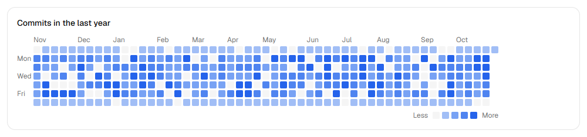

# Chartshelf charts

**The charts shadcn doesn't ship.** Free, MIT-licensed charts for [shadcn/ui](https://ui.shadcn.com). They use the same `ChartConfig` and theme tokens as shadcn charts.

> Need a heatmap, cohort retention grid, funnel, sankey, treemap, or waterfall? The paid Chartshelf pack adds them. [Join the waitlist](https://chartshelf-charts.vercel.app/#waitlist).

## Calendar heatmap



### Install

```bash
npx shadcn@latest add chartshelf/charts/calendar-heatmap
```

This adds `calendar-heatmap.tsx` and `calendar-heatmap-utils.ts`, plus the shadcn `chart` component if you do not have it.

### Use

```tsx
import { CalendarHeatmap } from "@/components/calendar-heatmap"

const data = [
  { date: "2026-10-20", value: 4 },
  { date: "2026-10-21", value: 9 },
]

export function Activity() {
  return (
    <CalendarHeatmap
      data={data}
      config={{ value: { label: "Commits", color: "var(--chart-1)" } }}
    />
  )
}
```

### Props

| Prop | Type | Default | Notes |
|---|---|---|---|
| `data` | `{ date: string; value: number }[]` | required | `date` is `YYYY-MM-DD`. Days with the same date add up. |
| `config` | `ChartConfig` | `value`: `var(--primary)`, `negative`: `var(--destructive)` | Same type as shadcn charts. `value` colors the scale, `negative` colors values under 0. |
| `from` | `string` | 364 days before `to` | First day. |
| `to` | `string` | last day in `data`, or today | Last day. |
| `weekStart` | `0 \| 1` | `0` | `0` starts weeks on Sunday, `1` on Monday. |
| `levels` | `number` | `4` | Number of color steps. |
| `max` | `number` | the highest value | Values at or above `max` get the strongest color. Use it to cap outliers. |
| `cellSize`, `gap` | `number` | `12`, `3` | Size in pixels. |
| `locale` | `string` | `"en-US"` | Month, weekday, date, and number format. |
| `loading` | `boolean` | `false` | Shows a pulsing grid. |
| `error` | `ReactNode` | none | Shows a message over the grid. |
| `emptyMessage` | `ReactNode` | `"No activity in this period"` | Shows when every value is 0. |
| `showLegend` | `boolean` | `true` | |
| `formatValue` | `(value: number) => string` | `Intl.NumberFormat` | |
| `onDayClick` | `(day) => void` | none | Makes days buttons. Enter and Space also work. |

### Accessibility

- The grid has one tab stop. Arrow keys move by day and week. Home and End go to the first and last day.
- Each day has a label, for example "Tue, Oct 21, 2026: 9 Commits".
- A hidden summary gives the total, the active days, and the highest day.

### Wide grids

The grid keeps its cell size. On narrow screens it scrolls sideways, shows the latest weeks first, and keeps the weekday labels in place.

## Develop

```bash
npm install
npm run dev    # demo page at http://localhost:3000
npm test       # logic tests
```

## License

MIT. See [LICENSE](./LICENSE). Not affiliated with shadcn/ui.
